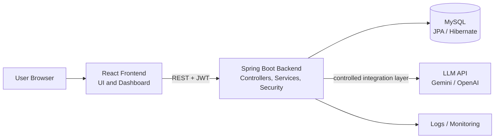
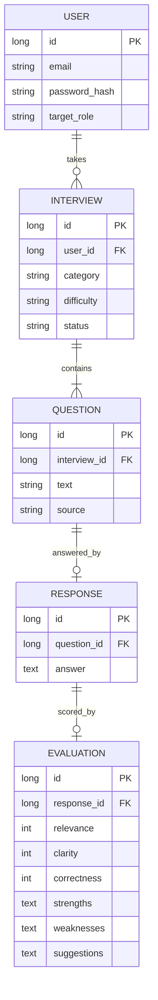
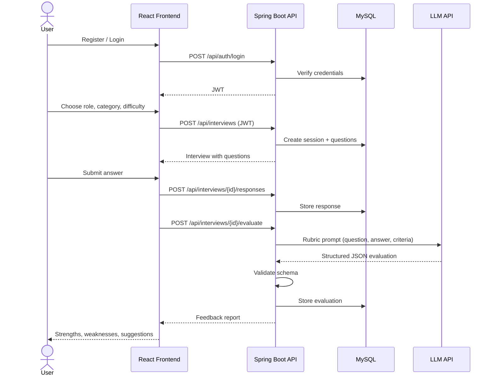
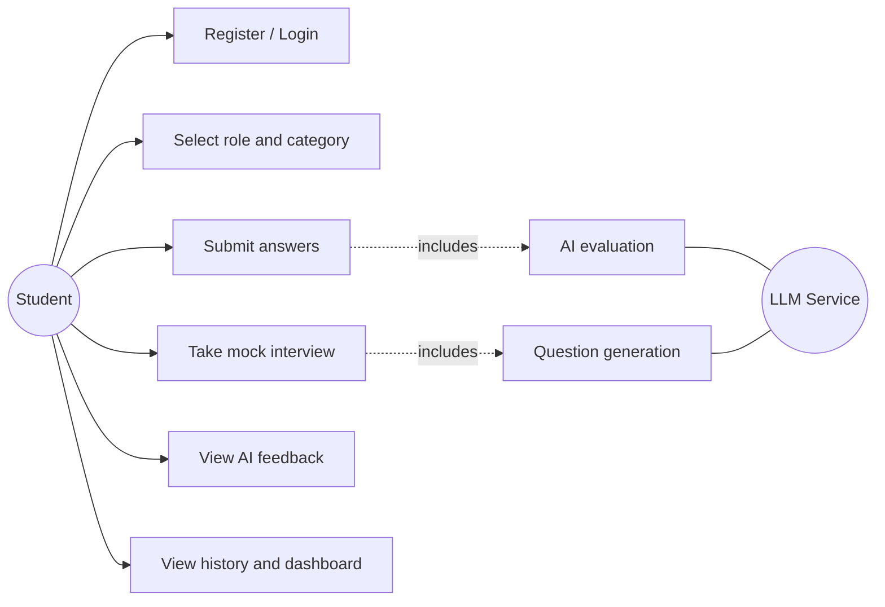
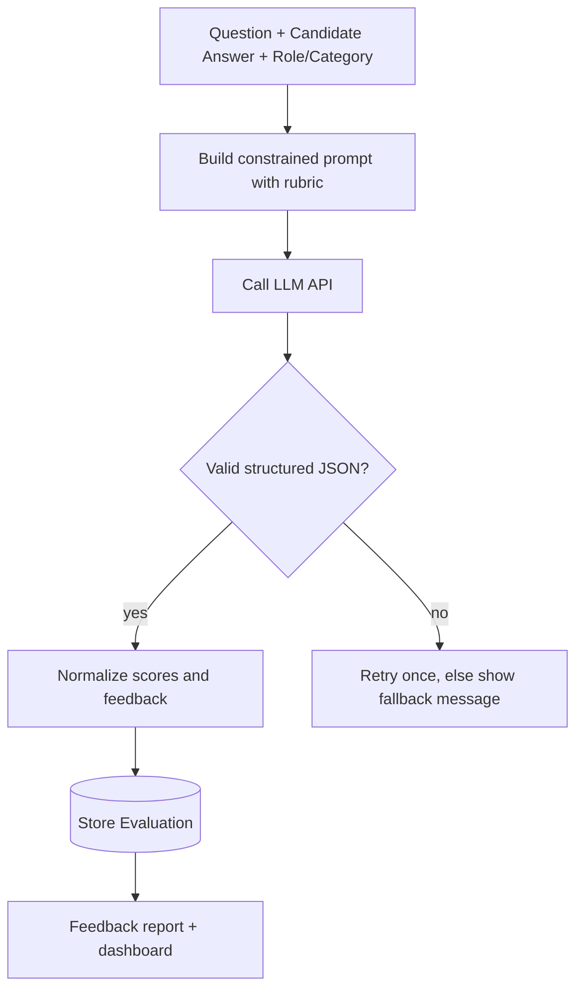

# IntervyoX: AI-Powered Mock Interview and Personalized Feedback Platform

## 1. Overview

IntervyoX is a web platform where students practice mock interviews and get structured feedback on their answers. A user picks a role and interview type, answers questions, and receives an AI-generated evaluation with strengths, weaknesses and suggestions. Past sessions are stored so progress can be tracked over time.

## 2. Problem and Objectives

Interview preparation is scattered across question banks, coding platforms, peer practice and paid coaching. Candidates rarely get one place that offers realistic practice together with immediate, structured feedback.

**Primary research question:** How can an AI-assisted web application provide structured mock interviews and personalized feedback while keeping the architecture secure, the evaluation criteria consistent and the system usable?

**Objectives**

- Build a modular platform for technical, HR and role-based mock interviews
- Provide secure registration and login using JWT
- Support configurable interview sessions with predefined and AI-generated questions
- Integrate an LLM for question generation and rubric-based answer evaluation
- Generate structured feedback (strengths, weaknesses, suggestions)
- Store interview history and show progress on a dashboard

## 3. System Architecture

The system has four parts: a React frontend, a Spring Boot backend, a MySQL database and an external LLM API. The backend sits in the middle and controls everything. It checks every request, enforces login and permissions, stores data, and is the only component that talks to the AI. The AI is used only to understand answers and write feedback.

## 4. Database Design

A user can take many interviews. Each interview contains many questions. Each question can have one response, and each response can have one evaluation. Foreign keys keep this history consistent and make it easy to fetch past performance.

## 5. Interview and Evaluation Flow

This shows what happens from login to feedback. The user logs in and receives a JWT, which is sent with every later request. They create an interview, the backend generates or selects questions, and the user submits answers. When an answer is evaluated, the backend sends a rubric-based prompt to the LLM, validates the structured JSON that comes back, saves it, and returns a feedback report.

## 6. Use Cases

The student is the main user. They can register and log in, choose a role and interview category, take the interview, submit answers, view AI feedback and review their history. Question generation and answer evaluation both rely on the LLM service.

## 7. AI Evaluation Pipeline

Each answer is evaluated against a fixed rubric so scoring stays consistent. The backend builds a prompt from the question, the answer, the role and the criteria, then asks the LLM for JSON output. If the JSON is valid, it is normalized and stored. If not, the backend retries once and then shows a fallback message.

Rubric dimensions: relevance, technical correctness (where applicable), clarity, completeness, reasoning and communication. AI feedback is advisory and is not a hiring decision.

## 8. Planned REST API

| Method | Endpoint                       | Purpose                  |
| ------ | ------------------------------ | ------------------------ |
| POST   | /api/auth/register             | Create account           |
| POST   | /api/auth/login                | Login, returns JWT       |
| GET    | /api/users/me                  | Current user profile     |
| POST   | /api/interviews                | Create interview session |
| GET    | /api/interviews/{id}           | Get interview            |
| POST   | /api/interviews/{id}/responses | Submit answer            |
| POST   | /api/interviews/{id}/evaluate  | Trigger AI evaluation    |
| GET    | /api/interviews/history        | Past interviews          |
| GET    | /api/dashboard/summary         | Progress summary         |

## 9. Tech Stack and Progress

**Stack:** React, Tailwind CSS | Java, Spring Boot, Spring Security, JWT | MySQL, JPA/Hibernate | Gemini / OpenAI API | JUnit, Postman | Git, GitHub

**Implementation progress** (ticked items are done)

- [x] Requirements, literature review, architecture and DB design
- [x] Spring Boot project setup
- [ ] MySQL schema and entities
- [ ] Registration and login with JWT
- [ ] Protected endpoint (/api/users/me)
- [ ] Interview creation API
- [ ] Response submission API
- [ ] LLM integration with rubric prompt
- [ ] React frontend
- [ ] Dashboard
- [ ] Testing and security hardening
- [ ] Deployment
